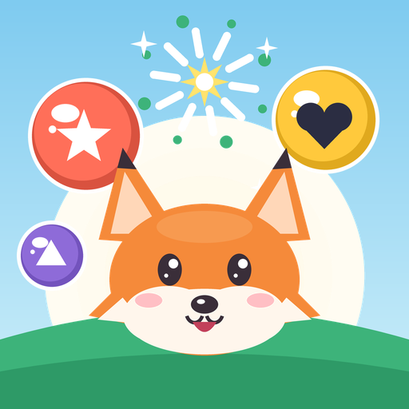

# Happy Tappy Pop



A cheerful bubble-popping game for toddlers and young kids. A friendly fox shows a target **color** or **shape**, and the player taps the matching bubbles as they float up the screen. It teaches colors and shapes, and gives practice with tapping.

The whole game is a single HTML file. It has no build step and no dependencies, and it collects no data.

## How to play

1. Pick a level: **Easy** 🐢, **Medium** 🐇 or **Hard** 🐆.
2. Look at the big circle in the top-left corner. It shows what to find, and it sparkles and chimes each time it changes.
3. Tap the bubbles that match. Wrong bubbles just wobble; there's no penalty.
4. At the start of each round, the matching bubbles glow as a hint.
5. Each correct tap puts a 🍫 in the fox's tray. Five chocolates earn a 🍭 lollipop sticker and a new target.
6. Three correct in a row makes the bubbles faster; two misses slow them down.
7. After five lollipops comes a party: a dancing giant lollipop and balloons that burst into chocolates. Then the game returns to the menu.

The **?** button on the start screen shows these rules in the game.

## Levels

| Level | Background | Bubbles | What to match |
|---|---|---|---|
| Easy | Playground | Big and slow | Color, then shape |
| Medium | Fun park with rides | Smaller, faster, swaying | Color, then shape |
| Hard | Zoo | Smallest, fastest, more sway | Color, shape, then **both** |

## Features

- **Animated title:** the fox hops across three balloons that pop to reveal *Happy*, *Tappy* and *Pop*, with candy bursts.
- **Sounds made by the browser:** pops, chimes and a music-box intro tune, generated with the Web Audio API. There are no audio files.
- **Volume slider** on the start screen. It starts at 50% and the browser remembers the setting.
- **🏠 button** to return to the menu at any time.
- **Fits any screen:** works on phones, tablets and desktops. Backgrounds switch to a closer view on narrow screens.
- **Accessibility:** a dark-mode palette, and reduced animation when the device asks for less motion.

## Running it

Open `index.html` in any modern browser; there's nothing to install.

To test on a phone on the same Wi-Fi, serve the folder:

```bash
python3 -m http.server 8000
```

Then open `http://<your-computer's-IP>:8000` on the phone.

> Browsers block sound until the first tap, so the intro tune plays after the player first touches the screen.

## Project structure

```
happytappypop/
├── index.html        # the entire game (HTML, CSS and JavaScript)
├── icon/
│   ├── icon-1024.png # master app icon (source for Android icon generation)
│   ├── icon-512.png  # Play Store listing icon
│   ├── icon-64.png   # small icon (also embedded in index.html as the favicon)
│   └── make_icon.py  # script that draws the icon
└── README.md
```

### Redrawing the icon

The icon is drawn in code with [Pillow](https://pypi.org/project/pillow/). After editing `make_icon.py`, run:

```bash
python3 icon/make_icon.py icon/icon
```

This rewrites the three PNG files. If you change the 64px icon, the copy embedded in `index.html` must be updated separately.

## Privacy

The game has no ads, analytics, accounts or network requests, apart from loading the *Baloo 2* font from Google Fonts. The only thing it stores is the volume setting, kept in the browser's `localStorage`.

## Roadmap: Android / Google Play

- [ ] Bundle the Baloo 2 font locally (needed for offline play and the Play Store's kids-app rules)
- [ ] Make Android's back button go to the menu
- [ ] Wrap the game with [Capacitor](https://capacitorjs.com/) and build a signed app bundle (`.aab`)
- [ ] Write a privacy policy, fill in the Play Console forms for apps aimed at children, and run a closed test
